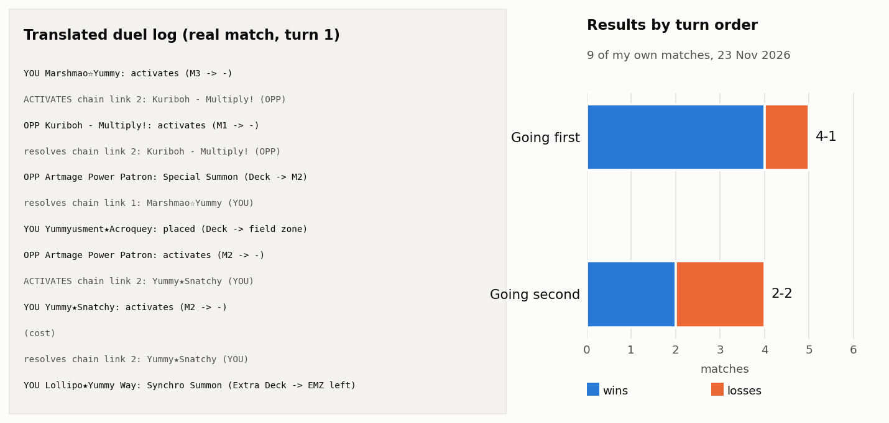

# Yu-Gi-Oh! Master Duel tools

Tools I build around Yu-Gi-Oh! Master Duel, the game I play competitively (Master I every season; favourite decks right now: Branded, Dracoslayer and Power Patron). This repository holds the match analytics project in full; my other Yu-Gi-Oh! projects are linked below.



## 1. Match recorder and analytics (this repository)

**Problem.** The game shows a duel log on screen (who played which card, in what order and how the opponent responded), but it cannot be exported and the game keeps no statistics. I wanted data-backed answers: how do I do going first versus going second, which cards did I play in the games I won, which opponent cards did my hand traps hit, and what did my first turn look like in each game.

**How it works.**

1. **Capture (private component, not published).** A hotkey starts a background recorder; from then on every duel is saved automatically when it ends, with no windows and an audio cue. It stores only what the game shows in its own duel log, and takes card names from the game itself (alternate arts and the monthly new cards included).
2. **Clean format.** One JSON file per match in [`match-analytics/data/`](match-analytics/data/): the log lists (plays, chains, phases, turns), final life points, which player is me, and card names.
3. **Play-by-play.** [`code/read_log.py`](match-analytics/code/read_log.py) turns each JSON into a turn-by-turn text: who plays which card, from which zone to which zone, and how each chain is built. Example: [`sample/`](match-analytics/sample/).
4. **Analysis.** [`code/analysis.py`](match-analytics/code/analysis.py) walks all matches and writes [`STATS.md`](match-analytics/STATS.md): results going first and second, the opponent's archetype inferred from the cards they revealed, cards I played and their record, hand traps and what they hit, and my full first-turn line.
5. **Figure.** [`code/figure.py`](match-analytics/code/figure.py) renders the image above.

```
cd match-analytics/code
python analysis.py                                     # writes ../STATS.md
python read_log.py --json ../data/2026-11-23_15-54-44.json
python figure.py                                       # writes ../figures/overview.png
```

Standard library Python plus matplotlib.

**Data quality.** Three attribution rules were corrected after checking the parser against real matches:

- **Owner of each play.** The local-player flag attached to card names is wrong when the opponent summons during my turn (for example, a Fusion Summon made by the opponent's quick effect in my turn showed up as mine). The true owner comes from a per-play field. With the old rule, a game I won showed up as a loss.
- **Turn player.** Read from each turn header, not inferred from the first card played in that turn.
- **Hidden cards.** A face-down card must not inherit the name of the previous card in the log.

**Results so far.** 9 of my own matches from 23 Nov 2026 (1,456 log records): 6 wins and 3 losses, 4-1 going first and 2-2 going second. Too few games to conclude anything yet; the dataset keeps growing on its own as I play.

**Next step.** Load the JSON files into SQLite and, at around 200 matches, train a model that predicts the opponent's deck from their first cards and estimates win probability from the board at the end of each turn.

## 2. Power Patron, solved for games without hand traps

On the open-source ygopro-core rules engine used by EDOPro, a bot played all 19,254 distinct opening hands of my Power Patron list and finds the first-turn kill in 91.8% of games going first without interruptions (weighted by draw odds). Every line can be replayed move by move, and lines are also tested against each hand-trap window. The performance-critical search is written in Rust; a measurement error was found and fixed by looking at the data.

- Live demo (pick five cards and watch the bot play them): https://dio-branded.github.io/power-patron-bot/
- The public site holds the replayer and the 19,254 results; the engine integration and the search code are private.

## 3. Other tools

- **Combo trainer for Radiant Typhoon / Zoodiac:** pick your hand, see the playable lines. Live: https://dio-branded.github.io/radiant-typhoon-helper/
- **Deck reader from screenshots:** a Master Duel screenshot in, a .ydk decklist out (perceptual hashing and SSIM). Showcase: https://github.com/Dio-Branded/ygo-card-identifier

## About

Marcelo García Luyo, Lima, Peru (UTC-5). Python developer and engineer (National University of Engineering, Peru).

Yu-Gi-Oh! is a trademark of Konami. Non-commercial fan project, not affiliated with or endorsed by Konami. Card names in the data come from the game client.
